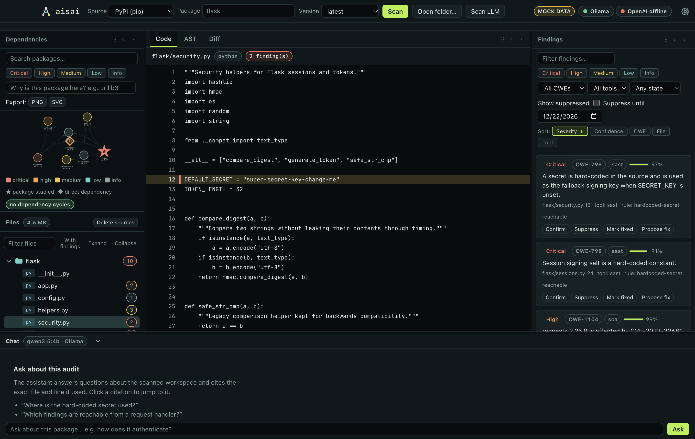
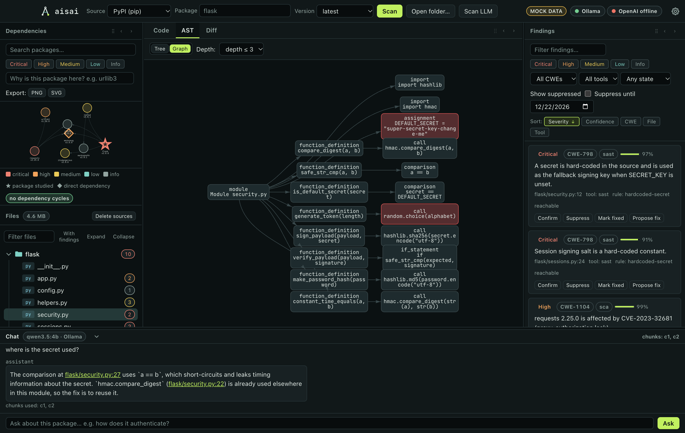
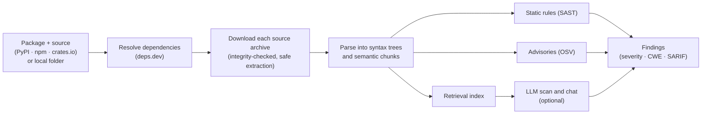
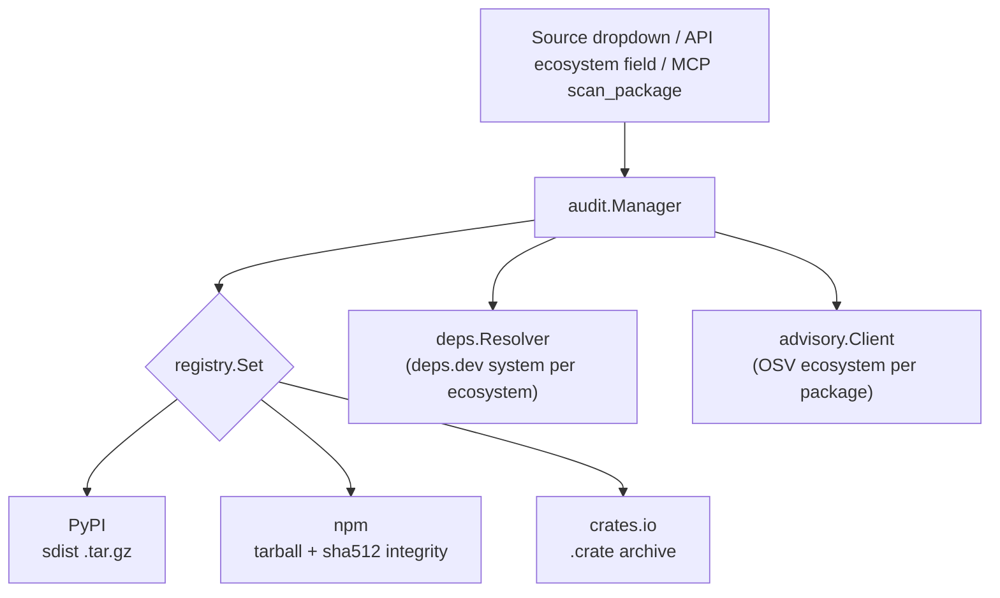
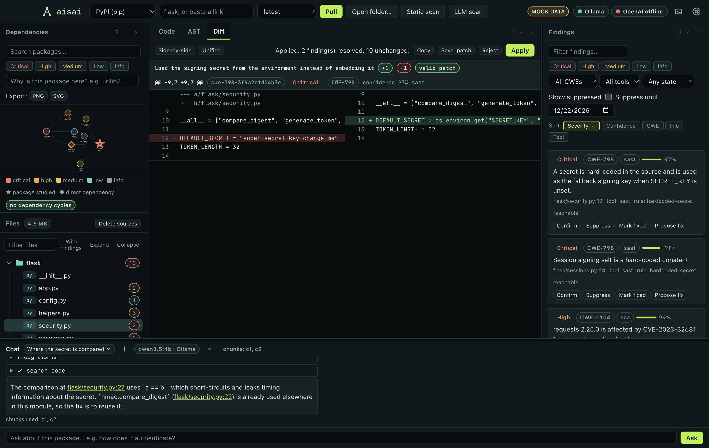
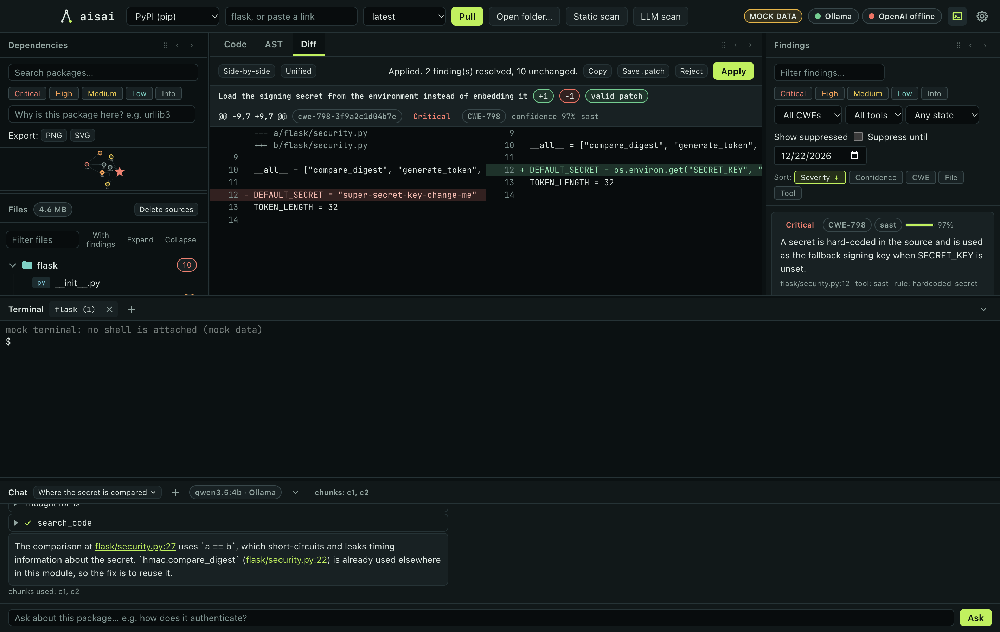

# AISAI

**AISAI: <ins>A</ins>utomated <ins>I</ins>dentification of <ins>S</ins>oftware Supply Chain Vulner<ins>a</ins>b<ins>i</ins>lity.**

AISAI finds software supply chain vulnerabilities in packages from **PyPI,
npm and crates.io**, and in local project folders. Give it a package name and
version; it resolves the dependency tree, downloads every source archive
safely, parses it into semantic chunks, runs static rules and an
LLM review over the code, and lets you interrogate the result — including
asking the LLM questions about the code itself.

Everything runs locally. The advisory database can be a local snapshot and the
model can be a local Ollama install, so an air-gapped machine can still run a
full audit.

> **This is a rewrite.** The original Python/Dash application is preserved
> under [`legacy/`](legacy/) and its documentation is in
> [`legacy/README-python.md`](legacy/README-python.md). See
> [`NOTES_improvements.md`](NOTES_improvements.md) for the audit that motivated
> the rewrite and [`PLAN_rewrite_electron_go.md`](PLAN_rewrite_electron_go.md)
> for the design.

## At a glance



The workspace after auditing a package: the dependency graph and files on the
left, the code with the flagged lines in the middle, findings on the right and
the chat below, which names the model that answers.

| | |
|---|---|
|  |  |
| **AST graph.** The syntax tree of the open file as a node-link diagram; nodes with a finding are red, a click jumps to the line. | **Layout presets.** Move panes by their grip, or pick an arrangement in Settings. |
|  |  |
| **Reader layout.** The dependency column is hidden and the chat is docked on the right. | **Package managers.** Choose PyPI, npm or crates.io, type a name or paste a link, then Pull. |

### How an audit runs



### Where each package manager plugs in



## Architecture

```
┌──────────────────────────── Electron ────────────────────────────┐
│  renderer (React + Zustand)                                      │
│    graph · file tree · code view · AST view · findings rail      │
│    diff view · chat panel                                        │
│         ▲ preload (contextBridge, no node access)                │
│  main process                                                    │
│    spawns the Go sidecar, proxies HTTP + WebSocket               │
└──────────────────────────────┬───────────────────────────────────┘
                               │ Unix socket (never the network)
┌──────────────────────────────▼───────────────────────────────────┐
│  Go backend  cmd/aisai-server                                    │
│    internal/audit    lifecycle: resolve → download → index       │
│    internal/registry package indexes: PyPI, npm, crates.io       │
│    internal/pypi     PyPI client + safe tar extraction (fuzzed)  │
│    internal/deps     deps.dev resolver (PyPI, npm, cargo)        │
│    internal/ast      tree-sitter parsing + semantic chunker      │
│    internal/sast     10 AST rules                                │
│    internal/scan     LLM detect → verify pipeline                │
│    internal/index    FTS5 + vectors, RRF fusion                  │
│    internal/chat     chat with prompt-injection quarantine       │
│    internal/findings SQLite store + SARIF export                 │
│    internal/advisory OSV client, online or offline               │
│    internal/patch    unified-diff apply, workspace-confined      │
└──────────────────────────────────────────────────────────────────┘
```

The backend is a library first and a server second: the same packages back
the Electron sidecar, the MCP stdio server, and the benchmark harness. That is
what makes it impossible for the app and the benchmark to disagree about what
a finding is.

## Requirements

| Requirement | Version |
|---|---|
| Go | 1.26+ (the tree-sitter bindings use cgo, so a C toolchain is required) |
| Node | 20+ |
| Ollama | optional; the LLM features need it |

If Go and Node are not on your `PATH`:

```bash
export PATH="/usr/local/go/bin:$PATH"   # go
export PATH="/usr/local/bin:$PATH"      # node, npm
```

## Quick start

```bash
make install-electron   # install renderer dependencies
make check              # gofmt, go vet, go test
make dev                # run the Electron app in development mode
```

To run the backend on its own:

```bash
make run                # listens on ./.aisai/aisai.sock
```

The server prints exactly one line of JSON on stdout — the address the
Electron main process connects to:

```json
{"address":"/path/to/.aisai/aisai.sock","transport":"unix","type":"listening","version":"0.5.0-dev"}
```

Everything else is logged to stderr.

### Without a model

Every LLM-backed feature can be switched off:

```bash
DISABLE_LLM=1 make run
```

Static analysis, the dependency graph, the file browser and the findings
store all still work.

## Configuration

Configuration is read from a JSON file (`--config`, or `AISAI_CONFIG`), then
overridden by environment variables.

| Variable | Purpose | Default |
|---|---|---|
| `AISAI_WORKSPACE` | Where audits are stored | `./.aisai` |
| `AISAI_CONFIG` | Path to the config file | — |
| `AISAI_SOCKET` | Unix socket path | temp dir |
| `AISAI_OLLAMA_URLS` | Comma-separated Ollama URLs, tried in order | `http://localhost:11434` |
| `AISAI_CHAT_MODEL` | Model for chat and the scan pipeline | `qwen3.5:4b` |
| `AISAI_SCAN_MODEL` | Model for detection | falls back to the chat model |
| `AISAI_EMBED_MODEL` | Model for embeddings | `embeddinggemma` |
| `AISAI_NUM_CTX` | Context window sent to the model | `8192` |
| `AISAI_SCAN_WORKERS` | Parallel detection workers | `4` |
| `AISAI_KEEP_ALIVE` | How long Ollama keeps a model in memory after the last request | `3m` |
| `DISABLE_LLM` | Turn off all LLM features | `false` |
| `AISAI_BYOK_BASE_URL` | OpenAI-compatible endpoint (optional) | — |
| `AISAI_BYOK_MODEL` | Model name for the BYOK endpoint | — |
| `AISAI_BYOK_API_KEY` | API key for the BYOK endpoint | — |
| `AISAI_OSV_DB` | Path to a local OSV database directory | — |
| `AISAI_ADVISORY_OFFLINE` | Force the offline advisory path | `false` |

The legacy environment names `OLLAMA_BASE_URL` and `OLLAMA_PRIMARY_MODEL` are
still honoured.

**`AISAI_NUM_CTX` matters.** The legacy app never set `num_ctx`, so Ollama
silently truncated at its 2048-token default and the model was reasoning about
half a file. The new server always sends `num_ctx` explicitly.

**`AISAI_KEEP_ALIVE` matters too.** Ollama keeps a model resident in memory
until no request has used it for the keep-alive window, and on a laptop with
8GB of unified memory a resident model is memory the rest of the system does
not have. The default of three minutes keeps a model warm across the steps of
one scan and gives the memory back afterwards; `0` unloads it as soon as the
request is done.

**The BYOK API key never leaves the backend.** It is not passed to the
renderer, not written to logs, and not included in error strings. The
config's `Redacted()` helper is used for every config surface. The key is
also never written to the configuration file: the model picker saves the
models it changes, and the key is not part of that.

## Models

AISAI uses three models: one for chat, one for the detection pipeline and
one for embeddings. The **model picker** in the settings dialog lists the
models installed on the Ollama server, shows how much memory each one
takes, and lets you choose any of them.

Choosing a model there takes effect immediately — the provider, the
detection pipeline and the chat all read the model names on every request,
so the next chunk of the next scan uses the new model. The choice is
written back to the configuration file, so it survives a restart.

The picker also warns when the selected model is larger than half of the
memory of the machine, which is the usual reason a model that "should fit"
turns out to be too slow.

### Releasing the memory

Every request carries a keep-alive window, so Ollama unloads a model three
minutes after the last request that used it. The **Release memory** button
in the picker does not wait for that: it asks Ollama to unload the models
immediately, which is useful before switching to a bigger model or before
closing the app on a laptop.

### Models that fit on an 8GB M2 MacBook Air

An 8GB MacBook Air has roughly 5.6GB of memory available to applications
once macOS and the browser have taken their share, and the memory is
shared between the CPU and the GPU. A model has to fit in that budget
*plus* the room the app itself needs, so anything above about 4GB is
already tight.

These are the models that fit and still do a decent job:

| Model | Size | Role | Notes |
|---|---|---|---|
| `qwen3.5:4b` | 3.3–4.0GB | chat and scan | The default. Tools, thinking and a 256K context, and it still leaves room for the app. |
| `qwen3.5:2b` | 2.7–3.1GB | chat | The comfortable choice: about 20 tokens per second on an M2, and it leaves 2GB free. |
| `qwen2.5-coder:7b` | 4.7GB | scan | The strongest code model that fits, but it needs nearly all of the free memory and leaves little for anything else. |
| `gemma4:e2b` | 4.6GB | chat | Multimodal (text, image and audio) in a small model. |
| `gemma4:e4b` | 6.6GB | chat | Runs, but it leaves under 1GB for everything else and the app starts to swap. |
| `embeddinggemma` | 287MB | embeddings | The default embedder: 300M parameters, and it is small enough to ignore. |

A reasonable setup for an 8GB Air is `qwen3.5:4b` for chat and scan with
`embeddinggemma` for embeddings. If the machine feels slow, drop the chat
model to `qwen3.5:2b` and keep the scan model at 4b — the detection
pipeline is the slow part, so it is worth keeping the stronger model there.

Two models to avoid on this machine: `gemma3n:e4b` (9.8GB) and
`qwen3.5:9b` (6.6GB) do not fit alongside the app, and `qwen3-coder:30b`
(19GB) is not a candidate at all.

## Air-gapped operation

1. Download an OSV database snapshot and point `AISAI_OSV_DB` at it.
2. Set `AISAI_ADVISORY_OFFLINE=1`.
3. Point `AISAI_OLLAMA_URLS` at a local Ollama.

With those set, the app performs no outbound network calls. The dependency
resolution uses deps.dev and the package downloads use the public package indexes, so a fully
offline audit needs a local mirror of both; that is not implemented yet.

## Inspecting a package

### The package picker

The toolbar holds a **Source** dropdown (the package manager: PyPI, npm or
crates.io), a package field and a version dropdown. Each source has its own
suggestions, and the packages are downloaded from that index. The version is
never typed by hand: it is either **latest** or one of the versions the
package index actually published, so an audit cannot silently run against a
release that does not exist.

Typing a name queries the index (`GET /api/packages`) and reports what the
name refers to — the canonical name, the latest release and the summary of
the project. The suggestions are the packages that were audited before and a
short list of the packages people actually install. `Enter` scans the typed
name, `Arrow Down` walks the suggestions.

### Pull, then scan

The toolbar separates fetching from analysis:

- **Pull** downloads a package (and its dependencies) or clones a repository into
  the audit. It does not scan. The package field also takes **pasted links**: a
  pypi.org, npmjs.com or crates.io page, a `pkg:` URL, or an `https` repository
  link (GitHub, GitLab, Codeberg and the like, including `/tree/<branch>` and
  release-tag links). A package link fills in the source, name and version; a
  repository link shows `owner/repo` and is cloned.
- **Static scan** runs the rule engine over what was pulled.
- **LLM scan** asks the model to review it. Both scan buttons are disabled until
  something has been pulled.

A repository is cloned with `git`, which must be installed. The clone is
deliberately narrow: HTTPS only, hosts that are IP addresses or have no dot are
refused, one shallow branch, no hooks, no submodules, none of your git
configuration or credentials, a 3-minute and 768 MB ceiling, and the files are
copied into the sandbox without `.git`, symlinks, dependency folders or large
files. Nothing from it is executed. Over the API, send `POST /api/audits` with
`{"url": "https://github.com/owner/repo"}`; `scan_package` over MCP takes a
`url` argument too.

### Package managers

| Source | Index | Dependency graph | Advisories |
|---|---|---|---|
| PyPI (`pypi`) | pypi.org source distributions | deps.dev, with a PyPI-metadata fallback | OSV `PyPI` |
| npm (`npm`) | registry.npmjs.org tarballs, checked against the published integrity hash | deps.dev | OSV `npm` |
| crates.io (`cargo`) | crates.io `.crate` archives | deps.dev | OSV `crates.io` |

Over the API, send `POST /api/audits` with `{"package": "express",
"ecosystem": "npm"}` (`ecosystem` defaults to `pypi`); `GET /api/ecosystems`
lists the supported indexes and `GET /api/packages?name=…&ecosystem=…` looks a
name up. Over MCP, `scan_package` takes an `ecosystem` argument. Package URLs
follow the ecosystem (`pkg:npm/@scope/name@1.0.0`). For npm and cargo, when
deps.dev cannot answer, only the root package is scanned and the graph says so,
because a semver range cannot be resolved without the package manager itself.

### The workspace layout

Every column can be moved: drag a pane by its **⋮⋮** grip onto another pane, or
use its **‹ ›** buttons. Drag an edge to resize it (double-click resets it).
**Settings → Layout** offers ready-made arrangements (Classic, Triage, Reader,
Focus, Supply-chain map), lets you hide the dependency and findings columns,
and docks the chat below or on the right. The arrangement is remembered.

### Editing, completion and selection actions

The code pane is an editor. Edit a file and save it (**Ctrl/Cmd+S**): the
backend backs the file up, records the edit as a diff, and re-scans the file, so
the findings follow your text and **Changes**, the exported patch series and
**Revert** all see it. The original download is never touched, only the audit's
copy.


- **Inline completion.** With a model available, ghost text appears after you
  pause typing at the end of a line. **Tab** accepts it, **Esc** dismisses it. A
  small badge in the file header says whether completion is on.
- **Select code** and a toolbar appears: **Ask in chat** attaches the selection
  to your next question, **Fix** asks the model to fix the weakness, and
  **Change…** takes an instruction ("use a constant-time comparison"). Fix and
  Change show the old and new code side by side; nothing reaches the editor until
  you press **Accept**, and undo takes it back.
- A finding's **Propose fix** opens the **Diff** tab with a patch for it, checked
  to apply before you can **Apply** it; the file is then re-scanned and the
  result shows which findings the patch resolved.

  

- Code under audit is untrusted. Every prompt tells the model the file is data,
  and a selection that contains instruction-like text is withheld from the chat
  rather than sent.

### Chat



Chat is organised in **threads** per audit: the first answer names the thread,
and from the thread menu you can rename, archive, restore or delete (deleting
asks twice). A turn that is still running shows a shimmering status ("Thinking…",
"Running search_code…"), a model that shows its reasoning gets a collapsible
**Thinking** block, and every tool call is listed with its arguments and result.
The thread so far is sent back to the model, so follow-up questions work.

The chat header names the model that answers (for example `qwen3.5:4b · Ollama`).
When no model is usable — no server configured, the server unreachable, or no
chat model selected — chat is explicitly limited: the input is disabled, the
header says *no model*, and the panel explains why and links to the model
settings. Scanning, the graph, the AST and the static rules keep working.

### Keyboard shortcuts

**⌘⇧/** (Ctrl+Shift+/ on Windows and Linux) shows them all; they are also under
**Settings → Layout → Keyboard shortcuts**. ⌘ is Ctrl outside macOS.

| Keys | Action |
|---|---|
| ⌘, | Settings |
| ⌘O | Open a project folder |
| ⌘L | Go to the package field (outside the editor) |
| ⌘⇧S / ⌘⇧L | Static scan / LLM scan |
| ⌘1 / ⌘2 / ⌘3 | Code / AST / Diff tab |
| ⌘B / ⌘⌥B | Show or hide the dependencies / findings pane |
| ⌘J | Go to the chat |
| ⌘⇧N | New chat |
| Ctrl+` | Show or hide the terminal |
| ⌘S | Save the file (editor) |
| Tab / Esc | Accept / dismiss the completion (editor) |

A shortcut never takes a key the editor or the field you are typing in already
uses.


### The terminal

Press **Ctrl+`** (or the terminal button in the toolbar) for a shell at the
bottom of the window, like an editor's. It opens in the audit's folder, can have
several tabs, and is a real login shell running as you, so treat it like any
terminal: nothing in it runs by itself, but a command you type runs for real.
Keep the audited code out of your shell's reach unless you mean to run it.
AISAI's own settings (`AISAI_*`, `BYOK_*`) are removed from its environment, and
`AISAI_DISABLE_TERMINAL=1` switches the feature off. The terminal works on macOS
and Linux; on Windows it is not available yet.



### The syntax tree

The **AST** tab shows the syntax tree of the open file either as a collapsible
**Tree** or as a **Graph**, a left-to-right node-link diagram. Both respect the depth
limit, mark nodes that carry a finding, and jump to the source line on click.
The graph draws at most 500 nodes and says when it leaves some out.

### Updates

The installed app updates itself, with no new download from the release page:
it checks the project's GitHub releases on launch and every six hours,
downloads the new version in the background, and shows **Restart to update** in
the toolbar when it is ready (it also installs when you quit).

- **Windows and Linux (AppImage)** update in place through electron-updater.
- **macOS** builds are ad-hoc signed, which Squirrel.Mac (electron-updater's
  macOS installer) refuses to update. AISAI does it itself instead: it downloads
  the zip for your Mac's architecture, checks its SHA-512 against the release's
  `latest-mac.yml`, unpacks it, checks that the app's code seal is intact and
  that it is AISAI, then on restart swaps it in and reopens it. The old copy is
  kept until the new one is in place. For this to work AISAI must run from a
  folder it can write to, such as **Applications**; run from a disk image or
  straight from Downloads, it shows **Update available: download** instead.
- Copies of 0.3.0 and earlier do not have this macOS updater, so on a Mac the
  move to 0.5.0 is one last manual download.

Set `AISAI_UPDATE_FEED_URL` to point the app at a private feed.

### Languages

An audit parses every source file it finds, not only the Python ones. AISAI
understands **Python, JavaScript, TypeScript, TSX, Go, Rust, Java, C#, Ruby,
C, C++, PHP, Scala and shell scripts (Bash, sh, zsh)**. The syntax tree, the semantic chunks and the retrieval index are
built for all of them, and the code view names the language of the file.

Python has the full rule set, with taint and scope tracking. The other
languages get pattern rules for the common sinks: command execution, code
evaluation, unsafe deserialization, weak hashes and ciphers, SQL built by
string concatenation, disabled TLS verification, XSS sinks, unsafe C
functions, format strings and hardcoded secrets. PHP adds `include` of a
request value, `unserialize` and `display_errors`; shell scripts add
`curl | sh`, `eval` of a variable, `curl -k` and `mktemp -u`. C++ and Scala
reuse the C and Java rules. These rules are heuristic and do not follow data
flow.

### Model servers

Scans and chat can use a model on this machine (Ollama, vLLM, llama.cpp or
LM Studio) or a hosted service with your own API key (OpenAI, Anthropic,
Gemini, OpenRouter, Groq or Mistral). Pick one in **Settings → Model
server**; the switch takes effect without a restart. API keys are stored in
the system keychain by the desktop app and are never written to the config
file.

### Inspecting a local project

Use **Open folder...** in the toolbar (Ctrl/Cmd+O), or drop a folder on the
window. The folder is copied into the sandbox and the copy is audited, so the
original is never changed. Hidden folders, dependency folders (`node_modules`,
`venv`, `vendor` and similar), symlinks and files over 2 MiB are skipped. Over
the API, send `POST /api/audits` with `{"path": "/abs/dir"}`. Over MCP, call
`scan_package` with `path`.

### The sandbox

The packages that are downloaded for an inspection are kept in a sandbox:
`pkgs/` inside the workspace of the audit.

- The archives are downloaded into a scratch space outside the sandbox and
  deleted as soon as they have been extracted. The sandbox only ever holds
  source files.
- Nothing is ever executed, and the executable and setuid bits an archive
  carried are stripped, so the sandbox stays inert.
- The files are hardened after the extraction, and a file bigger than 2 MB is
  left in the tree but not parsed.

The sandbox can be deleted when the inspection is over: **Delete sources** in
the header of the file pane asks twice, then removes the downloaded code
(`DELETE /api/audits/{id}/workspace`). The findings, the graph and the report
are kept — only the disk space goes away. The header shows how much the
sandbox holds.

## Safety properties

These are the properties the rewrite treats as non-negotiable.

- **The package under audit is never installed.** `pip install` executes the
  target's `setup.py`, which is exactly the code being audited. AISAI
  downloads source archives and resolves dependencies from metadata instead.
- **Archive extraction is validated.** Absolute paths, `..` escapes, and
  symlinks or hardlinks pointing outside the extraction root are all rejected;
  setuid/setgid bits are stripped; device nodes and FIFOs are skipped; total
  size and entry count are capped. `internal/pypi` has a fuzz target.
- **Path traversal has one chokepoint.** Every path that reaches the
  filesystem goes through `audit.ResolvePath`, which resolves symlinks and
  refuses anything outside the audit workspace.
- **The downloaded packages live in a sandbox.** They are extracted into
  `pkgs/`, never executed, stripped of the executable and setuid bits they
  carried, and can be deleted once the inspection is over.
- **The API is never on the network.** The server listens on a Unix socket.
- **Untrusted code is treated as data.** Chunks that look like instructions are
  quarantined before they reach the model, and the model is told to treat the
  code as data.
- **A candidate that cannot be verified is dropped, not downgraded.** The
  detect→verify pipeline exists because models reported false positives on
  safe code in over half of cases (ICPEC 2025).
- **Patches are verified by re-scanning.** Applying a fix re-runs the static
  rules over the patched file and reports what was resolved, introduced and
  left unchanged. Applying a fix only asserts that it worked; the re-scan is
  the evidence.

## Known limitations

- **Dependency versions are not historical.** deps.dev resolves a package's
  dependencies to their *current* versions, so auditing `flask==2.0.0` shows
  `click 8.5.1` rather than the `click 7.1.2` that was actually required at
  the time. The tree is accurate for the root package and approximate for
  transitive dependencies.
- **No reachability analysis yet.** Findings are reported per file and line
  but are not yet traced from an untrusted entry point.
- **Rules outside Python are pattern-based.** Python has taint and scope
  tracking. The other languages use call and line patterns, so they miss
  flows across functions and can flag safe code.
- **Fully offline operation is not complete.** The advisory database and the
  model can both be local, but dependency resolution still uses deps.dev and
  package downloads still use the public package indexes. A local mirror of
  both is not implemented.
- **The published releases are not signed.** The pipeline publishes an
  artifact for Windows, macOS and Linux on every tag, but the signing
  identities are not configured in this repository, so the artifacts are
  unsigned. See [Releases](#releases) below.
- **OSV is the only advisory source.** No NVD or GitHub Advisory Graph
  enrichment beyond what OSV already carries.
- **The LLM path has not been measured.** There is no Ollama on the machine
  this was built on, so the detection pipeline is covered by unit tests with
  a fake provider rather than by a live benchmark run.

## Layout

```
cmd/aisai-server     backend entry point
cmd/aisai-mcp        MCP stdio server for external agents
cmd/aisai-bench      benchmark harness
internal/            Go packages (the actual implementation)
electron/            Electron app
docs/API.md          the frozen HTTP + WebSocket contract
docs/plan/           workstream tracking and decisions
bench/               benchmark corpus and the untouched notebooks
legacy/              the original Python application
web/                 vendored vis-network, for the offline graph
```

## Export

An audit exports as SARIF 2.1.0 (for CI), CycloneDX 1.5 and SPDX 2.3 (for
SBOM consumers), or raw JSON.

```bash
curl --unix-socket "$SOCKET" "http://localhost/api/audits/$AID/export?format=cyclonedx" -o bom.cdx.json
```

The CycloneDX document carries the dependency tree as components, the
advisories as vulnerabilities and the findings as component properties. SPDX
has no vulnerability vocabulary, so there the advisories and findings become
package comments.

## The MCP server

AISAI can be driven by an external agent — Claude Code, Codex, Cursor. The
MCP server exposes the full audit as tools: `scan_package`,
`get_dependency_graph`, `list_files`, `get_source`, `get_ast`, `run_sast`,
`run_llm_scan`, `list_findings`, `get_finding`, `propose_fix`, `apply_patch`,
`export_report`, `search_code` and `ask_codebase`.

```bash
make build-server
make mcp    # prints the configuration to paste into your agent
```

The agent can then audit a package and read the findings without touching
the workspace itself.

## Benchmark

`bench/data1551redacted.csv` holds 1,551 paired vulnerable/fixed snippets.
The Go harness runs the same `internal/sast` and `internal/scan` code the app
uses and writes a CSV in the exact schema the existing notebooks
(`bench/notebooks/*.ipynb`) read. The notebooks have not been re-run against
the current harness.

```bash
make bench          # full run
make bench-quick    # a small slice, no LLM calls
make bench-baseline # trivial baselines for comparison
make bench-tfidf    # the TF-IDF + naive Bayes baseline on a held-out split
make bench-metrics  # the static engine plus the full metric set as JSON
make bench-external # RealVuln and OWASP BenchmarkPython
```

### Where the numbers stand

AISAI does not publish accuracy numbers of its own. A trustworthy detection
benchmark needs a large labelled corpus, long runs of every tool and model, and
independent replication, and this project has not had the hardware or the
review for that. The harness above is there so you can measure it yourself on
your own machine; until someone does and publishes the result, the honest
position is what the peer-reviewed and preprint literature says about the
approaches AISAI combines.

**Rule-based static analysis on Python (AISAI's static engine, Bandit,
Semgrep, CodeQL).** The most direct comparison found is a 2026 preprint,
[PyFlow: An Inter-procedural Static Analysis Framework for Python](https://arxiv.org/abs/2608.07026)
(Gu, Yan and Yao, arXiv:2608.07026), which runs Bandit, Semgrep and CodeQL on
108 real CVEs from 62 open-source Python projects and on 240 synthetic
programs. As read from the paper's tables, on the real-world set:

| tool | precision | recall | F1 |
|---|---|---|---|
| Bandit | 60.0% | 27.8% | 38.0% |
| Semgrep | 65.7% | 40.7% | 50.3% |
| CodeQL | 72.3% | 31.8% | 44.2% |

The pattern is the point: general-purpose static tools miss most real
vulnerabilities (recall under 41% here) even when most of what they report is
right. AISAI's rule engine is the same kind of tool, so expect the same
ceiling, and treat a clean static scan as the absence of *known patterns*, not
of vulnerabilities. This is a preprint; check the figures against the paper
before relying on them.

**LLMs reviewing code.** Two peer-reviewed studies bound what the optional LLM
scan can be trusted for:

- Ding et al., [Vulnerability Detection with Code Language Models: How Far Are We?](https://arxiv.org/abs/2403.18624)
  (ICSE 2025), built the PrimeVul dataset and found that a state-of-the-art 7B
  model scoring 68.26% F1 on the older BigVul benchmark scored only 3.09% F1 on
  PrimeVul. Larger models such as GPT-3.5 and GPT-4 did not close the gap, with
  results "akin to random guessing in the most stringent settings".
- Ullah et al., [LLMs Cannot Reliably Identify and Reason About Security Vulnerabilities (Yet?)](https://arxiv.org/abs/2312.12575)
  (IEEE S&P 2024), tested eight LLMs on 228 code scenarios and reported
  non-deterministic answers, incorrect and unfaithful reasoning, poor results on
  real-world code, and non-robustness: renaming functions or variables, or
  adding library calls, produced wrong answers in 26% of cases for PaLM2 and 17%
  for GPT-4.

This is why the LLM scan is a *second opinion*, not a verdict. Every LLM
finding goes through a separate verification step that tries to disprove it,
carries a confidence score, is clearly labelled with its tool, and is never
counted as proof. The line numbers it reports are re-anchored to the quoted
code, because models count lines badly. Use the findings as leads to read, and
confirm them in the code.

**What AISAI itself has verified.** Unit tests cover the rule engine, the
detection and verification pipeline (with a fake model), path-safe archive
extraction (including fuzzing), and the registry and resolver clients (against
stub servers). Those show the code does what it says. They are not accuracy
measurements, and nothing here claims one.

## Releases

Every tag that starts with `v` publishes a GitHub release with the desktop
app for all three platforms:

| Platform | Artifacts |
|---|---|
| Windows (x64) | NSIS installer and a zip |
| macOS (arm64 and x64) | DMG and zip |
| Linux (x64 and arm64) | AppImage and deb |

```bash
git tag v0.5.0
git push origin v0.5.0
```

The pipeline builds the Go backend once and hands it to every platform
build, writes the SBOM of the build alongside the artifacts, and attaches
the checksums to the release. The artifacts are also downloadable from the
release page itself.

The release can also be started by hand from the **Actions** tab, which
asks for the version to release.

**Signing.** The pipeline is configured for code signing and notarisation,
and it refuses to publish an artifact it cannot sign. Those credentials do
not exist in this repository yet, so the pipeline currently builds
*unsigned* artifacts and publishes them; see [`docs/RELEASE.md`](docs/RELEASE.md)
for the secrets to add. An unsigned macOS build is quarantined by Gatekeeper
and has to be opened with a right-click, and an unsigned Windows build shows
a SmartScreen warning.

## Development

```bash
make check          # gofmt + vet + tests
make test-electron  # renderer tests
make typecheck      # renderer typecheck
make lint           # renderer lint
make fmt            # format Go sources
make tidy           # tidy go.mod
make smoke          # end-to-end test against the real PyPI/deps.dev/OSV
```

`make smoke` starts the backend on a Unix socket, audits a real package, and
checks every stage: the health endpoint, the dependency graph, the file tree,
the code view, the AST view, the static scan, the advisory lookup, and the
apply → re-scan → revert patch loop. It needs network access but no LLM.

## License

MIT. The vendored `web/vis-9.1.2` is MIT/Apache-2.0. See
[`legacy/README-python.md`](legacy/README-python.md) for the original project's
licensing notes.
