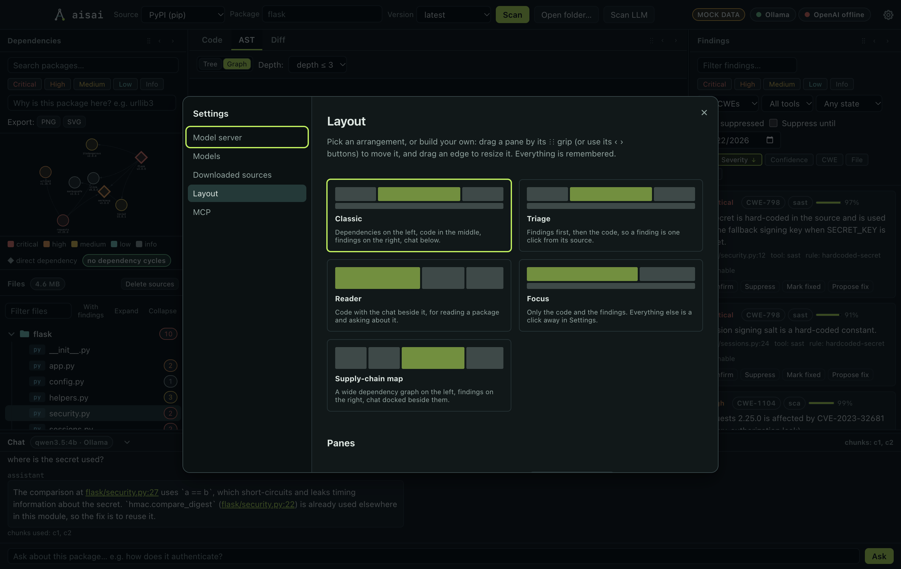
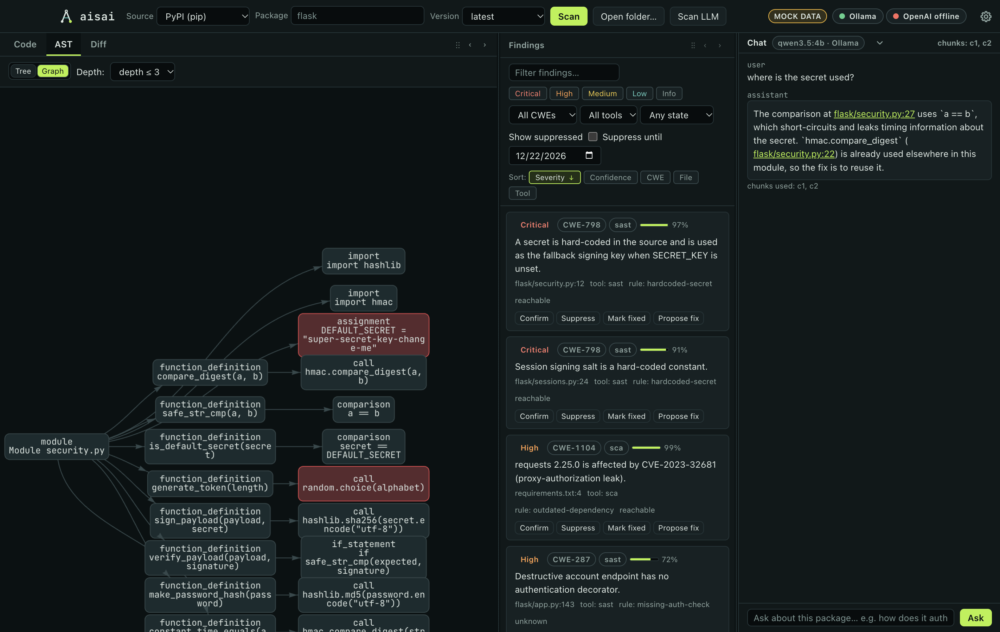
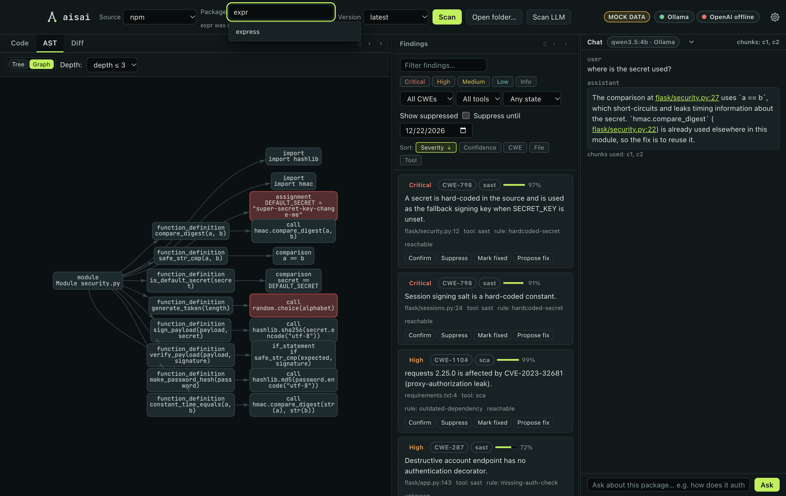
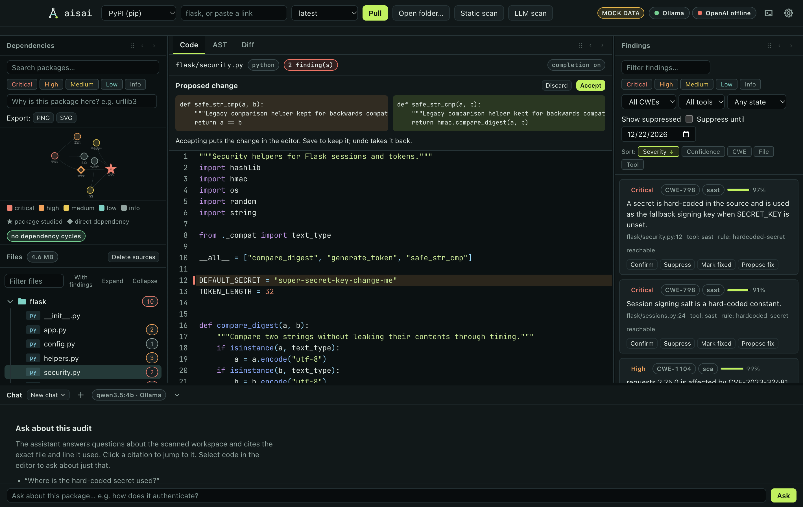
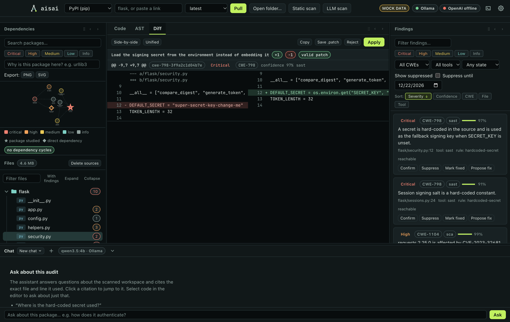
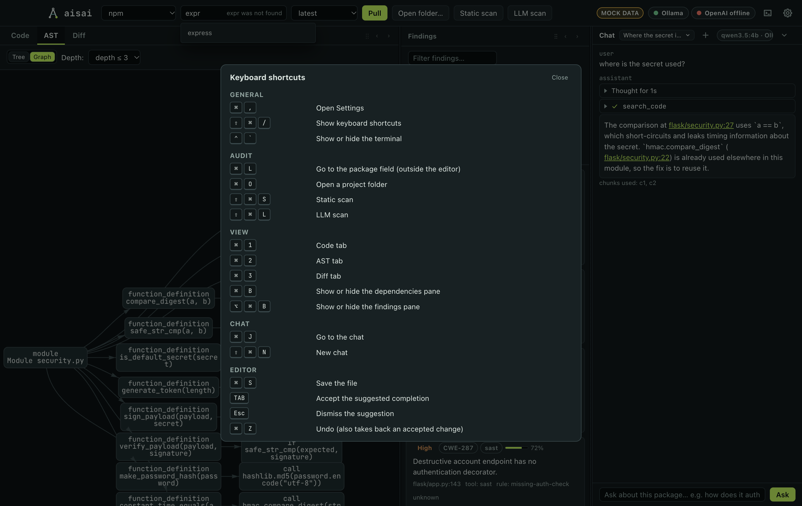
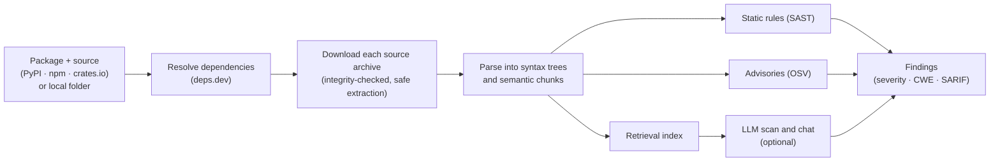
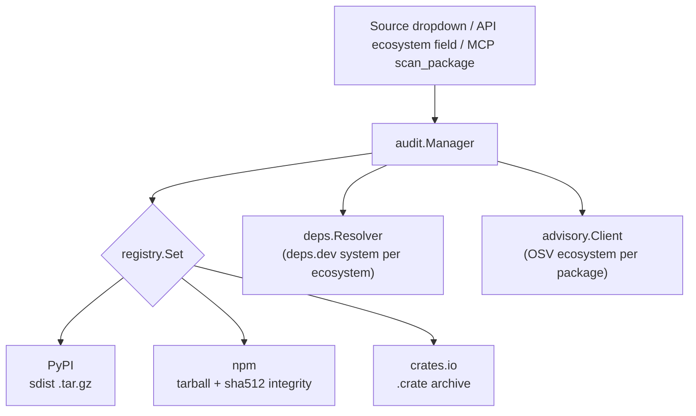

# AISAI

**<ins>A</ins>utomated <ins>I</ins>dentification of <ins>S</ins>oftware Supply Chain Vulner<ins>a</ins>b<ins>i</ins>lity**

AISAI finds software supply chain vulnerabilities in packages from **PyPI, npm and crates.io**, and in project folders on your computer. Give it a package; it resolves the dependency tree, downloads every source archive safely (nothing is ever installed or run), parses the code into syntax trees, runs static rules and an optional LLM review, and lets you question the result, including asking a model about the code itself.

Everything can run locally. The advisory database can be a local snapshot and the model a local Ollama install, so an air-gapped machine can still run a full audit.

> **This is a rewrite.** The original Python/Dash application is kept under [`legacy/`](legacy/), documented in [`legacy/README-python.md`](legacy/README-python.md). [`NOTES_improvements.md`](NOTES_improvements.md) is the review that motivated the rewrite and [`PLAN_rewrite_electron_go.md`](PLAN_rewrite_electron_go.md) its design.

## Contents

- [At a glance](#at-a-glance)
- [Features](#features)
- [Getting started](#getting-started)
- [Using AISAI](#using-aisai)
- [Models and model servers](#models-and-model-servers)
- [Configuration](#configuration)
- [How it works](#how-it-works)
- [Safety properties](#safety-properties)
- [Known limitations](#known-limitations)
- [Export, MCP and benchmarks](#export-mcp-and-benchmarks)
- [Releases](#releases)
- [Development](#development)
- [License](#license)

## At a glance


The workspace after auditing a package: the dependency graph and files on the left, the code with the flagged lines in the middle, the findings on the right, and the chat below, which names the model that answers.

| | |
|---|---|
|  |  |
| **AST graph.** The syntax tree of the open file as a node-link diagram. Nodes with a finding are red; a click jumps to the line. | **Layout presets.** Move panes by their grip, or pick an arrangement in Settings. |
|  |  |
| **Reader layout.** The dependency column is hidden and the chat is docked on the right. | **Package managers.** Choose PyPI, npm or crates.io, type a name or paste a link, then Pull. |

## Features

**Audit**
- Packages from PyPI, npm and crates.io, Git repositories by link, or a folder on your computer.
- The full dependency tree, drawn as a graph sized by importance and coloured by the worst finding.
- **Why is this package here?** Type or paste a name, a requirement line, a `pkg:` URL or an index page, and see the chain of packages that pulled it in.
- Static rules for 14 languages, with taint analysis that follows untrusted input to dangerous calls in Python, Rust, JavaScript/TypeScript, Go and Java, and rules for Rust's `unsafe` and FFI code.
- **Vulnerable dependencies, transitive ones included.** A project's lockfile gives the full dependency tree with exact versions; each package is checked against OSV, and every vulnerability shows the chain of packages that pulls it in, so you know which direct dependency to update.
- **Scan just one file**, statically or with the model, from the file's header.
- An optional LLM scan whose findings are verified before they are reported.
- Download and scan progress with an estimate of the time left, and clear errors when the disk is full.

**Read and fix**
- An editor with findings marked in the margin, a see-through minimap, inline completion and editor themes.
- **Inline chat:** select code and press ⌘K (Ctrl+K) to say how it should change. The proposal comes back as a line diff, and nothing changes until you accept it.
- Proposed patches in a Diff tab, re-scanned after they are applied to show what they fixed.
- AI edits type themselves into the editor and glow briefly, as one undo step.

**Ask**
- Chat about the package in threads, with answers that cite files and lines.
- Messages can be edited, branched into a new thread or asked again. Long conversations are compacted automatically.
- See which files the assistant reads and which commands it runs, with Allow and Deny for anything that is not read-only.
- Optional web search with cited links, for models that can call tools. The app tells you when the chosen model cannot.

**Debug and report**
- A Python debugger for your own projects: breakpoints, stepping, the call stack, variables, values shown on the paused line, and an evaluate console.
- Reports as PDF (laid out for paper) or HTML, plus SARIF, CycloneDX and SPDX exports.

**Make it yours**
- Light and dark themes, accent colours, ten editor themes and adjustable code size.
- Every keyboard shortcut can be changed, and the menus show your keys.
- Accessibility options: interface size, higher contrast, colour-blind-friendly severities, strong focus rings, wider text spacing and reduced motion.
- Built-in tutorials that walk through the app.

## Getting started

### From a release

Download the app for your platform from the [latest release](https://github.com/tlmcguire/aisai/releases/latest) and open it. On first launch, the welcome screen offers a two-minute tour; **Help › Tutorials** brings the tours back at any time.

The releases are not code-signed yet, so macOS asks you to open the app with a right-click the first time, and Windows shows a SmartScreen warning. See [Releases](#releases).

### From source

| Requirement | Version |
|---|---|
| Go | 1.26 or later. The tree-sitter bindings use cgo, so a C toolchain is needed too. |
| Node | 20 or later |
| Python 3 | Optional; only the debugger needs it. |
| Ollama or another model server | Optional; only the LLM features need one. |

```bash
make install-electron
```

```bash
make check
```

```bash
make dev
```

`make install-electron` installs the app's dependencies, `make check` runs the Go quality gate (gofmt, go vet, go test), and `make dev` starts the app in development mode. If Go or Node are not on your `PATH`, add them first, for example `export PATH="/usr/local/go/bin:/usr/local/bin:$PATH"`.

To run the backend on its own:

```bash
make run
```

It listens on `./.aisai/aisai.sock` and prints exactly one line of JSON on stdout, the address the Electron main process connects to; everything else goes to stderr:

```json
{"address":"/path/to/.aisai/aisai.sock","transport":"unix","type":"listening","version":"0.5.0-dev"}
```

### Without a model

Every LLM feature can be switched off. Static analysis, the dependency graph, the file browser, the debugger and the findings store keep working.

```bash
DISABLE_LLM=1 make run
```

## Using AISAI

### Pull, then scan

The toolbar separates fetching from analysis:

- **Pull** downloads a package (and its dependencies) or clones a repository. It does not scan. The package field also takes pasted links: a pypi.org, npmjs.com or crates.io page, a `pkg:` URL, or an `https` repository link (GitHub, GitLab, Codeberg and the like, including `/tree/<branch>` and release-tag links).
- **Static scan** runs the rule engine over what was pulled.
- **LLM scan** asks the model to review it. Both scan buttons stay disabled until something has been pulled.

The version is never typed by hand: it is either **latest** or a version the index actually published, so an audit cannot silently run against a release that does not exist. Typing a name looks it up on the index and shows its canonical name, latest release and summary; **Enter** pulls it and **↓** walks the suggestions.

The project being inspected is always named in the toolbar, with its version and source. When its downloaded sources are deleted, the chip says so and points you back to pulling.

A repository is cloned with `git`, which must be installed. The clone is deliberately narrow: HTTPS only, no hosts that are IP addresses or have no dot, one shallow branch, no hooks, no submodules, none of your git configuration or credentials, a three-minute and 768 MB ceiling. The files are copied into the sandbox without `.git`, symlinks, dependency folders or large files.

### Package managers

| Source | Index | Dependency graph | Advisories |
|---|---|---|---|
| PyPI (`pypi`) | pypi.org source distributions | deps.dev, with a PyPI-metadata fallback | OSV `PyPI` |
| npm (`npm`) | registry.npmjs.org tarballs, checked against the published integrity hash | deps.dev | OSV `npm` |
| crates.io (`cargo`) | crates.io `.crate` archives | deps.dev | OSV `crates.io` |

For npm and cargo, when deps.dev cannot answer, only the root package is scanned and the graph says so, because a semver range cannot be resolved without the package manager itself.

### Local projects

Use **Open folder…** (⌘O / Ctrl+O, also in the **File** menu) or drop a folder on the window. The folder is copied into the sandbox and the copy is audited, so the original is never changed. Hidden folders, dependency folders (`node_modules`, `venv`, `vendor` and similar), symlinks and files over 2 MiB are skipped. The dependency graph is built from the project's lockfiles when it has them (`Cargo.lock`, `package-lock.json`, `poetry.lock`, `Pipfile.lock`, `go.mod`, pinned `requirements*.txt`): the whole resolved tree, with exact versions and the edges between packages. Without a lockfile it is only what the manifests declare, one level deep. Folders inside the project that are repositories of their own (git worktrees, submodules, checked-out copies) are skipped, because they are separate projects and often full copies of this one; the toolbar chip names how many were left out.

### The dependency graph

Packages are sized by importance (the audited package, then direct dependencies, then by how much was found) and only the ones with findings carry a severity colour. The layout settles and then stops moving. Hover a package for a summary, including how many vulnerable packages are further down; export the graph as PNG or SVG. A **Package list** under the graph reaches every package with the keyboard and a screen reader.

**Vulnerable dependencies** lists what the OSV database knows about the packages in the graph, worst first: the severity, the advisory (a link to its page), the affected package and version, a summary, the versions that fix it, and the chain that pulls it in (`chrono → time`), each name a chip that selects it in the graph. For a package you downloaded this runs by itself after the pull. For a **local project** it runs when you press *Check for vulnerabilities*, because it sends the names and versions of the locked packages to osv.dev (your code is not sent). A package that comes from git or a path, or whose version is only a range, cannot be matched and is skipped. The result also appears in the HTML and PDF report.

**Why is this package here?** sits above the graph. It understands what people paste (`urllib3>=2.0; python_version<"3.12"`, `requests[socks]==2.31`, `pkg:pypi/urllib3@2.2.1`, `https://pypi.org/project/urllib3/`, `@types/node@20`), compares names the way Python normalises them (`typing-extensions` finds `typing_extensions`), suggests matches as you type, and offers close spellings when a name is mistyped. With nothing typed, it lists the packages that were pulled in indirectly. The answer shows the shortest chain from the audited package, as chips that select each package in the graph, and the other packages that also need it.

### The workspace

Every column can be moved: drag a pane by its **⋮⋮** grip, or use its **‹ ›** buttons. Drag a divider to resize; double-click resets it. The terminal and chat dividers carry a grab handle whose arrows also step the panel bigger or smaller with a click. **Settings › Layout** offers ready-made arrangements (Classic, Triage, Reader, Focus, Supply-chain map), hides the dependency and findings columns, and docks the chat below or on the right. In a narrow window the toolbar wraps onto a second row, so the settings and terminal buttons never disappear.

### Editing, completion and inline chat

The code pane is an editor. Save with **⌘S** (Ctrl+S) or **File › Save**: the backend backs the file up, records the edit as a diff and re-scans the file, so the findings follow your text. Undo and redo (⌘Z, ⇧⌘Z / Ctrl+Z, Ctrl+Y) work from the keyboard and the **Edit** menu, even when the focus has moved off the editor. Only the audit's copy is ever changed.



- **Inline completion.** With a model available, ghost text appears when you pause at the end of a line. **Tab** accepts, **Esc** dismisses, and the switch in the file header (or ⌘⌥K) turns it off.
- **Select code** and a toolbar appears: **Change…** (⌘K) to say how the code should change, **Fix** for a bug or weakness, **Explain** to have the chat walk through it, and **Ask…** to attach it to your own question. The instruction box suggests common changes and remembers earlier ones (↑).
- The proposal comes back as a **line diff** with added and removed counts. **Accept** (⌘↵) puts it in the editor as one undo step, **Discard** (Esc) drops it, **Try again** asks once more, and a box under the diff asks for a further change to the proposal.
- A finding's **Propose fix** opens the **Diff** tab with a patch, checked to apply before you can apply it; the file is then re-scanned and the result shows which findings the patch resolved.



Code under audit is untrusted. Every prompt tells the model the file is data, and a selection that contains instruction-like text is withheld from the chat rather than sent.

### Chat


Chat is organised in **threads** per audit: the first answer names the thread, and the thread menu renames, archives, restores or deletes it. A running turn shows what it is doing ("Thinking…", "Read flask/app.py", "Ran grep -rn eval ."); a model that shows its reasoning gets a collapsible **Thinking** block.

- **Edit, branch and retry.** Edit a question to ask it again (the answers after it are replaced), branch an answer into a new thread, or ask again. A failed answer says why (server not running, bad key, context too long, model missing) with **Try again**.
- **Compaction.** The whole conversation is sent, and when it no longer fits, the older turns are summarised; the chat says when that happened.
- **Tools and approvals.** The assistant can open files and run commands in the package workspace, with no shell, a 20-second limit and capped output. Read-only commands that stay inside the workspace (`ls`, `cat`, `grep`, `find`…) run at once. Anything else shows the exact command with **Allow** and **Deny**; no answer within two minutes counts as Deny, and the step then reads *not run* with the reason. A few commands are never allowed (`sudo`, `dd`, `chmod`, `kill`…).
- **Web search.** Off by default; switch it on in **Settings › Appearance**. The assistant can then search (DuckDuckGo, no key needed) and read pages, and cited pages appear as links. You are asked once per answer before the first search, because the search text leaves your computer. Page fetches refuse local-network addresses.
- **Models that cannot call tools.** Web search, file reading and commands need a model with tool support. When the chosen model has none, the chat header shows **no web search** (or **no tools**), Settings says so next to the web search switch, and an answer given without tools carries a note explaining why it may be thinner. With Ollama this is known before you ask; other servers are found out on the first question.

The chat header names the model that answers (for example `qwen3.5:4b · Ollama`). When no model is usable, chat is explicitly limited: the input is disabled and the panel explains why and links to the model settings. Everything else keeps working.

### The debugger

The debugger runs Python files of **projects you opened yourself**. It is never offered for downloaded packages, because it runs the code.

- **Breakpoints:** click a line number, or press **F9** on the cursor line. They move with the code when you edit above them, and the Debug panel lists them.
- **Start:** **Debug** in the file header, or **F5**. The first time, you confirm that the program will run on your computer with your permissions. **⌘F10** (Ctrl+F10) runs to the cursor line.
- **While paused:** the line is highlighted, the values of the variables it uses appear at its end, and hovering a name shows its value. The **Debug** view of the bottom panel has the controls (continue F5, pause F6, step over F10, into F11, out ⇧F11, restart, stop ⇧F5), the call stack, the breakpoints, the variables of the selected frame, and a console that shows the program's output and evaluates expressions.
- An uncaught exception stops where it happened, so you can look at the variables first.

It uses the project's own virtual environment (`.venv`, `venv` or `env`) when there is one, and `python3` otherwise. Nothing has to be installed: the driver is built on the standard library's [`bdb`](https://docs.python.org/3/library/bdb.html). It runs AISAI's copy of the folder, so the breakpoints match the code the editor shows. `AISAI_DISABLE_DEBUGGER=1`, or the terminal's switch, turns it off.

### The terminal

**Ctrl+`** (or the terminal button) opens a shell at the bottom of the window, in the audit's folder, with as many tabs as you need. It is a real login shell running as you: nothing in it runs by itself, but a command you type runs for real, so keep the audited code out of its reach unless you mean to run it. AISAI's own settings (`AISAI_*`, `BYOK_*`) are removed from its environment, and `AISAI_DISABLE_TERMINAL=1` switches it off. On macOS and Linux it runs on a pseudo-terminal; on Windows it runs PowerShell (or `cmd.exe`) on a ConPTY pseudo-console, which needs Windows 10 version 1809 or later. The Windows path is new and has been built and vetted but not yet run on a real Windows machine.


### The syntax tree

The **AST** tab shows the syntax tree of the open file as a collapsible **Tree** or as a **Graph**. Both respect the depth limit, mark nodes that carry a finding and jump to the source line on click. The graph starts with 500 nodes, says how many it leaves out, and offers to draw 500 more at a time up to 3,000; the tree always shows every node. It exports as PNG or SVG.

### Scanning one file

The code header has **Scan file**, which runs the static rules over the open file only (**⌘⌥S** / Ctrl+Alt+S), and **LLM review**, which asks the model to review only that file. A one-file static scan re-reads the saved file, replaces that file's findings and marks the ones that disappeared as fixed. Save first: a scan reads the file on disk. Over the API, `POST /api/audits/{id}/scan` takes a `path` next to the `engine`.

### Reports

The findings rail exports a report as **PDF** or **HTML**, and so does **File › Export Report** (⌘⇧E for PDF).

- **PDF** is laid out for paper: a light page with print-safe severity colours, findings never split across pages, wrapped code, and a header and page numbers on every page. US Letter on a US English system, A4 elsewhere.
- **HTML** is one self-contained page in the app's theme, with no scripts and no external resources, so it can be mailed or archived as it is. Printing it from a browser gives the same paper layout.

The PDF is printed from the HTML report in a hidden window that cannot run scripts or reach the network, because the report quotes the audited code.

### Keyboard shortcuts

**⌘⇧/** (Ctrl+Shift+/) or **Help › Keyboard Shortcuts** shows them all. Every shortcut except copy, paste, select all and the editor's Tab and Esc can be changed in **Settings › Keyboard**: click a shortcut's keys and press new ones. A combination that another action uses, that the system keeps (⌘Q, ⌘W…) or that would type a character is refused with the reason. Changes apply at once and the menus show them. ⌘ is Ctrl outside macOS.

| Keys | Action |
|---|---|
| ⌘, | Settings |
| ⌘O | Open a project folder |
| ⌘S | Save the open file |
| ⌘Z / ⇧⌘Z (Ctrl+Y) | Undo / redo |
| ⌘⇧E | Export the report as PDF |
| ⌘L | Go to the package field |
| ⌘⇧S / ⌘⇧L | Static scan / LLM scan |
| ⌘1 / ⌘2 / ⌘3 | Code / AST / Diff tab |
| ⌘B / ⌘⌥B | Show or hide the dependencies / findings pane |
| ⌘J / ⌘⇧N | Go to the chat / new chat |
| ⌘K | Change the selected code (inline chat) |
| ⌘⌥K | Inline completion on or off |
| Ctrl+` | Show or hide the terminal |
| F9 | Set or remove a breakpoint |
| F5 / ⇧F5 / ⌘⇧F5 | Debug or continue / stop / restart |
| F6 / F10 / F11 / ⇧F11 | Pause / step over / step into / step out |
| ⌘F10 | Run to the cursor line |

A shortcut never takes a key that the editor or the field you are typing in already uses.



### Appearance and accessibility

**Settings › Appearance** sets the light, dark or system theme, the accent colour, and the editor: its theme (Verdigris dark and light, One Dark, Dracula, Nord, Solarized dark and light, GitHub Light, and high contrast dark and light), font size, line spacing and the minimap.

**Settings › Accessibility** has:

- **Interface size**, from 85% to 130%.
- **Higher contrast**, which also switches the editor to its high-contrast theme when it follows the app.
- **Colour-blind-friendly severity colours**, from the [Okabe–Ito palette](https://jfly.uni-koeln.de/color/). Severities are always written out as well.
- **A strong focus ring** on whatever has focus, after a click as well as with the keyboard.
- **Underlined links.**
- **Wider spacing** between letters, words and lines in prose.
- **Reduced motion**, following the system or always on. This stops sliding panels, the typewriter reveal of AI edits and the graph's settling animation.
- **A steady cursor** instead of a blinking one.

Every control can be reached with the keyboard.

### Updates

The installed app updates itself: it checks the project's GitHub releases on launch and every six hours, downloads the new version in the background, and shows **Restart to update** when it is ready (it also installs when you quit). **Settings › About** shows the version and checks on demand.

- **Windows and Linux (AppImage)** update in place through electron-updater.
- **macOS** builds are ad-hoc signed, which electron-updater's macOS installer refuses to update, so AISAI does it itself. It downloads the zip for your Mac's architecture, checks its SHA-512 against the release's `latest-mac.yml`, checks that the app's code seal is intact and that it is AISAI, then swaps it in on restart. AISAI must run from a folder it can write to, such as **Applications**; run from a disk image or from Downloads, it shows **Update available: download** instead.
- Copies of 0.3.0 and earlier do not have the macOS updater, so on a Mac the move to 0.5.0 is one last manual download.

Set `AISAI_UPDATE_FEED_URL` to point the app at a private feed.

### Downloaded sources

Downloaded packages live in a sandbox, `pkgs/` inside the audit's workspace. **Delete sources** in the file pane's header (it asks twice) removes the downloaded code; the findings, the graph and the report are kept. **Settings › Downloaded sources** lists every audit's sources with their size.

## Models and model servers

Scans and chat can use a model on this machine (Ollama, vLLM, llama.cpp or LM Studio) or a hosted service with your own API key (OpenAI, Anthropic, Gemini, OpenRouter, Groq or Mistral). Pick one in **Settings › Model server**; the switch takes effect without a restart.

API keys are stored in the system keychain by the desktop app and never written to the config file. On macOS the keychain item is called **AISAI Safe Storage**; the app only reads it once a key has been saved, so it does not ask for your password at every launch.

AISAI uses three models: one for chat, one for the detection pipeline and one for embeddings. The **model picker** in **Settings › Models** lists the models installed on the Ollama server, shows how much memory each takes, and warns when one is larger than half of the machine's memory. A choice takes effect on the next request and is written back to the configuration file.

Every request carries a keep-alive window, so Ollama unloads a model three minutes after the last request that used it. **Release memory** in the picker unloads them at once, which helps before switching to a bigger model or closing the app on a laptop.

For chat with web search, file reading and commands, choose a model that can call tools, such as `qwen3` or `llama3.1`.

### Models that fit on an 8 GB M2 MacBook Air

An 8 GB MacBook Air has roughly 5.6 GB available to applications once macOS and the browser have taken their share, shared between the CPU and the GPU. A model has to fit in that budget plus the room the app needs, so anything above about 4 GB is already tight.

| Model | Size | Role | Notes |
|---|---|---|---|
| `qwen3.5:4b` | 3.3–4.0 GB | chat and scan | The default. Tools, thinking and a 256K context, and it still leaves room for the app. |
| `qwen3.5:2b` | 2.7–3.1 GB | chat | The comfortable choice: about 20 tokens a second on an M2, leaving 2 GB free. |
| `qwen2.5-coder:7b` | 4.7 GB | scan | The strongest code model that fits, but it needs nearly all of the free memory. |
| `gemma4:e2b` | 4.6 GB | chat | Multimodal (text, image and audio) in a small model. |
| `gemma4:e4b` | 6.6 GB | chat | Runs, but leaves under 1 GB for everything else and the app starts to swap. |
| `embeddinggemma` | 287 MB | embeddings | The default embedder. |

A reasonable setup is `qwen3.5:4b` for chat and scan with `embeddinggemma` for embeddings. If the machine feels slow, drop the chat model to `qwen3.5:2b` and keep the scan model at 4b, because the detection pipeline is the slow part. Avoid `gemma3n:e4b` (9.8 GB) and `qwen3.5:9b` (6.6 GB), which do not fit alongside the app.

## Configuration

Configuration is read from a JSON file (`--config`, or `AISAI_CONFIG`), then overridden by environment variables.

| Variable | Purpose | Default |
|---|---|---|
| `AISAI_WORKSPACE` | Where audits are stored | `./.aisai` |
| `AISAI_CONFIG` | Path to the config file | none |
| `AISAI_SOCKET` | Unix socket path | temp dir |
| `AISAI_OLLAMA_URLS` | Comma-separated Ollama URLs, tried in order | `http://localhost:11434` |
| `AISAI_CHAT_MODEL` | Model for chat and the scan pipeline | `qwen3.5:4b` |
| `AISAI_SCAN_MODEL` | Model for detection | the chat model |
| `AISAI_EMBED_MODEL` | Model for embeddings | `embeddinggemma` |
| `AISAI_NUM_CTX` | Context window sent to the model | `8192` |
| `AISAI_SCAN_WORKERS` | Parallel detection workers | `4` |
| `AISAI_KEEP_ALIVE` | How long Ollama keeps a model in memory after the last request | `3m` |
| `DISABLE_LLM` | Turn off all LLM features | `false` |
| `AISAI_BYOK_BASE_URL` | OpenAI-compatible endpoint | none |
| `AISAI_BYOK_MODEL` | Model name for that endpoint | none |
| `AISAI_BYOK_API_KEY` | API key for that endpoint | none |
| `AISAI_OSV_DB` | Path to a local OSV database directory | none |
| `AISAI_ADVISORY_OFFLINE` | Force the offline advisory path | `false` |
| `AISAI_DISABLE_TERMINAL` | Turn off the terminal (and the debugger) | unset |
| `AISAI_DISABLE_DEBUGGER` | Turn off the debugger | unset |
| `AISAI_UPDATE_FEED_URL` | A private update feed | GitHub releases |

The legacy names `OLLAMA_BASE_URL` and `OLLAMA_PRIMARY_MODEL` are still honoured.

**`AISAI_NUM_CTX` matters.** The legacy app never set `num_ctx`, so Ollama silently truncated at its 2048-token default and the model reasoned about half a file. The server always sends it.

**`AISAI_KEEP_ALIVE` matters too.** On a laptop with 8 GB of unified memory, a resident model is memory the rest of the system does not have. Three minutes keeps a model warm across one scan and gives the memory back afterwards; `0` unloads it after every request.

**The API key never leaves the backend.** It is not passed to the renderer, not written to logs or error messages, and not written to the configuration file.

### Air-gapped operation

1. Download an OSV database snapshot and point `AISAI_OSV_DB` at it.
2. Set `AISAI_ADVISORY_OFFLINE=1`.
3. Point `AISAI_OLLAMA_URLS` at a local Ollama.

With those set, advisories and models make no outbound calls. Dependency resolution still uses deps.dev and downloads still use the public indexes, so a fully offline audit needs local mirrors of both, which are not implemented yet.

## How it works

### An audit



### Where each package manager plugs in



### Architecture

```
┌──────────────────────────── Electron ────────────────────────────┐
│  renderer (TypeScript, zustand stores, CodeMirror, vis-network,  │
│            xterm.js; no framework)                               │
│    graph · file tree · editor · AST view · diff · findings       │
│    chat · terminal · debugger · settings · tutorials             │
│         ▲ preload (contextBridge, no Node access)                │
│  main process                                                    │
│    spawns the Go sidecar, proxies HTTP + WebSocket, menus,       │
│    keychain, PDF printing, updates                               │
└──────────────────────────────┬───────────────────────────────────┘
                               │ Unix socket (never the network)
┌──────────────────────────────▼───────────────────────────────────┐
│  Go backend  cmd/aisai-server                                    │
│    internal/audit     lifecycle: resolve → download → index      │
│    internal/registry  package indexes: PyPI, npm, crates.io      │
│    internal/pypi      PyPI client + safe tar extraction (fuzzed) │
│    internal/deps      deps.dev resolver (PyPI, npm, cargo)       │
│    internal/ast       tree-sitter parsing + semantic chunker     │
│    internal/sast      static rules                               │
│    internal/scan      LLM detect → verify pipeline               │
│    internal/index     FTS5 + vectors, RRF fusion                 │
│    internal/chat      chat, tools, approvals, compaction         │
│    internal/websearch search and page reading, SSRF-guarded      │
│    internal/debug     Python debugger sessions (bdb driver)      │
│    internal/terminal  shells on pseudo-terminals                 │
│    internal/findings  SQLite store, SARIF and HTML reports       │
│    internal/advisory  OSV client, online or offline              │
│    internal/patch     unified-diff apply, workspace-confined     │
└──────────────────────────────────────────────────────────────────┘
```

The backend is a library first and a server second: the same packages back the Electron sidecar, the MCP server and the benchmark harness, so the app and the benchmark cannot disagree about what a finding is. [`docs/ARCHITECTURE.md`](docs/ARCHITECTURE.md), [`docs/API.md`](docs/API.md) and [`docs/THREAT_MODEL.md`](docs/THREAT_MODEL.md) go deeper.

### Languages

An audit parses every source file it finds: **Python, JavaScript, TypeScript, TSX, Go, Rust, Java, C#, Ruby, C, C++, PHP, Scala and shell scripts** (Bash, sh, zsh). The syntax tree, the chunks and the retrieval index are built for all of them.

Three layers of rules apply, by language:

- **Pattern rules (all languages).** Command execution, code evaluation, unsafe deserialization, weak hashes and ciphers, SQL built by string concatenation, disabled TLS verification, XSS sinks, unsafe C functions, format strings and hardcoded secrets. PHP adds `include` of a request value, `unserialize` and `display_errors`; shell scripts add `curl | sh`, `eval` of a variable, `curl -k` and `mktemp -u`. C++ and Scala reuse the C and Java rules. They look at one call or one line, so they report the dangerous construct, not where its input came from.
- **Taint analysis (Python, Rust, JavaScript, TypeScript, Go, Java).** It asks whether a value an attacker controls reaches a dangerous call. Sources are HTTP request values, command-line arguments, environment variables, standard input, the contents of files and network responses; sinks are commands, code evaluation and library loading, SQL, file paths, markup output, server-side requests, deserializers, redirects, and (in Rust and Go) raw memory sizes, indexes and allocation sizes. It follows values through declarations, assignments, string building and method chains within a function, and one level into functions of the same file. A sanitizer (an escape function, a basename) ends the taint; a numeric parse ends it for text sinks but not for sizes and indexes. Overwriting a value outside a branch makes it clean again, and a check such as `starts_with` lowers a finding's confidence instead of hiding it. Every finding carries its path: where the value came from, each step, and the sink. Values supplied by whoever runs the program (arguments, environment, standard input) are rated lower, because there is usually no attacker there. It does not follow values across files, through containers or across branches.
- **Rust's escape hatches.** Safe Rust cannot corrupt memory, so a review of Rust is mostly a review of the places that opt out. The rules mark every `unsafe` block and function (naming what is inside), unchecked operations (`transmute`, `from_raw_parts`, `get_unchecked`, `set_len`, `assume_init`, raw pointer reads and writes), `unsafe impl Send` and `Sync`, `static mut`, extern blocks and functions exported over the C ABI, and a safe `pub fn` whose parameter reaches a raw memory operation unchecked, which breaks the promise a safe function makes.

## Safety properties

These are the properties the rewrite treats as non-negotiable.

- **The package under audit is never installed or run.** `pip install` executes the target's `setup.py`, which is exactly the code being audited. AISAI downloads source archives and resolves dependencies from metadata instead. The debugger and the assistant's commands only ever run in a folder you opened yourself, and only after you confirm.
- **Archive extraction is validated.** Absolute paths, `..` escapes and links pointing outside the extraction root are rejected; setuid and setgid bits are stripped; device nodes and FIFOs are skipped; total size and entry count are capped. `internal/pypi` has a fuzz target.
- **Downloads live in a sandbox.** Archives are downloaded to a scratch space and deleted after extraction; the sandbox holds only source files, without executable bits, and can be deleted once the inspection is over.
- **Path traversal has one chokepoint.** Every path that reaches the filesystem goes through `audit.ResolvePath`, which resolves symlinks and refuses anything outside the audit workspace.
- **The API is never on the network.** The server listens on a Unix socket, and the renderer can only reach an allow-listed set of API paths through the main process.
- **Untrusted code is treated as data.** Chunks that look like instructions are quarantined before they reach the model, and the model is told to treat the code as data. The PDF report is printed with scripts and network off.
- **A candidate that cannot be verified is dropped, not downgraded.** The detect → verify pipeline exists because models reported false positives on safe code in over half of cases (ICPEC 2025).
- **Patches are verified by re-scanning.** Applying a fix re-runs the static rules over the patched file and reports what was resolved, introduced and left unchanged.

## Known limitations

- **Dependency versions are not historical.** deps.dev resolves dependencies to their *current* versions, so auditing `flask==2.0.0` shows `click 8.5.1` rather than the `click 7.1.2` required at the time. The tree is accurate for the root package and approximate for transitive dependencies.
- **A very large local folder is copied only in part.** The copy stops at 20,000 files or 256 MB; the toolbar chip says *partial copy* when that happens.
- **No reachability analysis yet.** Findings are reported per file and line but not traced from an untrusted entry point.
- **Taint analysis stays inside a file.** It follows values through a function and one level into functions of the same file, not across files or through collections, and it does not follow branches, so it can miss a flow or report one a check already prevents (it says when a check exists). Rules for languages other than Python, Rust, JavaScript, TypeScript, Go and Java are pattern-based.
- **Lockfile formats.** Cargo.lock, package-lock.json, poetry.lock, Pipfile.lock, go.mod and pinned requirements are read; yarn.lock, pnpm-lock.yaml and uv.lock are not yet. go.mod and Pipfile.lock record no tree, so their indirect packages hang directly off the project and the chain is one name long.
- **Fully offline operation is not complete.** See [Air-gapped operation](#air-gapped-operation).
- **The Windows terminal and debugger are untested.** Both build for Windows, and stopping a debugged program there ends its whole process tree, but neither has been run on a real Windows machine.
- **The debugger is Python only.** It does not pass keyboard input to the program, pause waits for the next line of Python (it cannot interrupt a blocking call), variables cannot be expanded, and files the copy left out (large data files) are missing when the program runs.
- **Web search depends on DuckDuckGo's HTML results page**, which can change without notice.
- **The releases are not signed.** See [Releases](#releases).
- **OSV is the only advisory source.** There is no NVD or GitHub Advisory enrichment beyond what OSV carries.
- **The LLM path has not been measured.** The detection pipeline is covered by unit tests with a fake provider rather than a live benchmark run.

## Export, MCP and benchmarks

### Export

Besides the PDF and HTML reports, an audit exports as SARIF 2.1.0 (for CI), CycloneDX 1.5 and SPDX 2.3 (for SBOM consumers), or raw JSON:

```bash
curl --unix-socket "$SOCKET" "http://localhost/api/audits/$AID/export?format=cyclonedx" -o bom.cdx.json
```

The CycloneDX document carries the dependency tree as components, the advisories as vulnerabilities and the findings as component properties. SPDX has no vulnerability vocabulary, so there the advisories and findings become package comments.

### The MCP server

An external agent (Claude Code, Codex, Cursor) can drive a whole audit through the MCP server's tools: `scan_package`, `get_dependency_graph`, `list_files`, `get_source`, `get_ast`, `run_sast`, `run_llm_scan`, `list_findings`, `get_finding`, `propose_fix`, `apply_patch`, `export_report`, `search_code` and `ask_codebase`. See [`docs/MCP.md`](docs/MCP.md).

```bash
make mcp
```

This builds the server and prints the configuration to paste into your agent.

### Benchmark

`bench/data1551redacted.csv` holds 1,551 paired vulnerable and fixed snippets. The Go harness runs the same `internal/sast` and `internal/scan` code as the app and writes a CSV in the schema the notebooks in `bench/notebooks/` read. The notebooks have not been re-run against the current harness. See [`docs/BENCHMARKING.md`](docs/BENCHMARKING.md).

| Command | What it runs |
|---|---|
| `make bench` | The full run |
| `make bench-quick` | A small slice, with no LLM calls |
| `make bench-baseline` | Trivial baselines for comparison |
| `make bench-tfidf` | A TF-IDF and naive Bayes baseline on a held-out split |
| `make bench-metrics` | The static engine with the full metric set, as JSON |
| `make bench-external` | RealVuln and OWASP BenchmarkPython |

### Where the numbers stand

AISAI does not publish accuracy numbers of its own. A trustworthy benchmark needs a large labelled corpus, long runs of every tool and model, and independent replication, which this project has not had. The harness is there so you can measure it yourself; until someone does, the honest position is what the literature says about the approaches AISAI combines.

**Rule-based static analysis on Python.** The most direct comparison found is a 2026 preprint, [PyFlow: An Inter-procedural Static Analysis Framework for Python](https://arxiv.org/abs/2608.07026) (Gu, Yan and Yao, arXiv:2608.07026), which runs Bandit, Semgrep and CodeQL on 108 real CVEs from 62 open-source Python projects. As read from the paper's tables, on the real-world set:

| Tool | Precision | Recall | F1 |
|---|---|---|---|
| Bandit | 60.0% | 27.8% | 38.0% |
| Semgrep | 65.7% | 40.7% | 50.3% |
| CodeQL | 72.3% | 31.8% | 44.2% |

General-purpose static tools miss most real vulnerabilities (recall under 41% here) even when most of what they report is right. AISAI's rule engine is the same kind of tool, so treat a clean static scan as the absence of *known patterns*, not of vulnerabilities. This is a preprint; check the figures against the paper before relying on them.

**LLMs reviewing code.** Two peer-reviewed studies bound what the optional LLM scan can be trusted for:

- Ding et al., [Vulnerability Detection with Code Language Models: How Far Are We?](https://arxiv.org/abs/2403.18624) (ICSE 2025), found that a 7B model scoring 68.26% F1 on the older BigVul benchmark scored only 3.09% F1 on their PrimeVul dataset, and that larger models such as GPT-3.5 and GPT-4 did not close the gap.
- Ullah et al., [LLMs Cannot Reliably Identify and Reason About Security Vulnerabilities (Yet?)](https://arxiv.org/abs/2312.12575) (IEEE S&P 2024), tested eight LLMs on 228 code scenarios and reported non-deterministic answers, unfaithful reasoning and poor robustness: renaming functions or variables produced wrong answers in 26% of cases for PaLM2 and 17% for GPT-4.

That is why the LLM scan is a *second opinion*, not a verdict. Every LLM finding goes through a verification step that tries to disprove it, carries a confidence score, is labelled with its tool, and is re-anchored to the quoted code because models count lines badly. Use the findings as leads, and confirm them in the code.

**What AISAI itself has verified.** Unit tests cover the rule engine, the detection and verification pipeline (with a fake model), path-safe archive extraction (including fuzzing), the registry and resolver clients (against stub servers), the debugger (against a real Python) and the renderer's logic. They show the code does what it says; they are not accuracy measurements.

## Releases

Every tag that starts with `v` publishes a GitHub release with the desktop app for all three platforms:

| Platform | Artifacts |
|---|---|
| Windows (x64) | NSIS installer and a zip |
| macOS (arm64 and x64) | DMG and zip |
| Linux (x64 and arm64) | AppImage and deb |

```bash
git tag v0.5.0 && git push origin v0.5.0
```

The pipeline builds the Go backend once and hands it to every platform build, writes the build's SBOM alongside the artifacts, and attaches the checksums. A release can also be started by hand from the **Actions** tab.

**Signing.** The pipeline is set up for code signing and notarisation and refuses to publish an artifact it cannot sign once the credentials exist. They do not exist in this repository yet, so it currently publishes *unsigned* artifacts; [`docs/RELEASE.md`](docs/RELEASE.md) lists the secrets to add. An unsigned macOS build is quarantined by Gatekeeper and has to be opened with a right-click, and an unsigned Windows build shows a SmartScreen warning.

## Development

| Command | What it does |
|---|---|
| `make check` | gofmt, go vet and the Go tests |
| `make test-electron` | The renderer's unit tests |
| `make typecheck` | Typechecks the renderer |
| `make lint` | Lints the Go tree and the Electron app |
| `make fmt` | Formats the Go sources |
| `make tidy` | Tidies `go.mod` |
| `make smoke` | An end-to-end run against the real PyPI, deps.dev and OSV |

`make smoke` starts the backend on a Unix socket, audits a real package and checks every stage: the health endpoint, the dependency graph, the file tree, the code view, the AST view, the static scan, the advisory lookup, and the apply → re-scan → revert patch loop. It needs network access but no model.

### Repository layout

```
cmd/aisai-server     backend entry point
cmd/aisai-mcp        MCP stdio server for external agents
cmd/aisai-bench      benchmark harness
internal/            Go packages (the implementation)
electron/            the desktop app (main process, preload, renderer)
docs/                API contract, architecture, threat model, release notes
bench/               benchmark corpus and the original notebooks
legacy/              the original Python application
web/                 vendored vis-network, for the offline graph
```

## License

MIT. The vendored `web/vis-9.1.2` is MIT/Apache-2.0, and the editor themes use colour palettes their authors publish under the MIT licence. See [`legacy/README-python.md`](legacy/README-python.md) for the original project's licensing notes.
